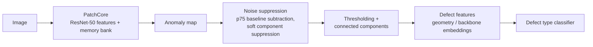

# PatchCore Defect Detection: Parallel Acceleration and Defect Classification

Course project for **Acceleration and Processing of Information** (3rd year, semester 6) at Don State Technical University (DSTU), carried out as part of an industrial practice.
The task: take an industrial anomaly-detection pipeline based on **PatchCore**, speed it up with parallel processing **without changing detection quality**, and add a second stage that **classifies the type** of each detected defect.

The experiments use the open **MVTec AD** benchmark (category *carpet*, 5 defect types: color, cut, hole, metal contamination, thread).

## Pipeline



The backend is a **FastAPI** service with endpoints for single-image, folder and batch analysis, calibration, parameter optimisation, binarisation tuning and defect classification; `frontend/index.html` is a browser UI on top of it.

## 1. Acceleration

The same analysis was run in **8 execution modes**: sequential processing, `ThreadPool` over images, `ProcessPool`, CUDA GPU, batched embedding, parallel processing of the defects inside one image, and their combinations.

**Key findings**

- **Parallelism does not change the result.** Accuracy, F1, Precision, Recall and Mean IoU are identical in all 8 modes, so every speed-up comes for free in terms of detection quality.
- **Best mode: "Combined CPU"**, a `ThreadPool` over images plus parallel processing of the defects within each image. It exploits parallelism on **two independent levels**.
- **`ThreadPool` scales up to 4 workers and then saturates**, as predicted by **Amdahl's law**: the ResNet forward pass runs under a `threading.Lock` and forms the sequential part of the workload.
- **`ProcessPool` pays off only when an image has many contours.** With few defects the cost of pickling data between processes exceeds the gain.

All measured runs (mode, number of workers, device, time, speed-up, estimated parallel fraction) are logged in [`backend/history.json`](backend/history.json) (3,300+ runs).

## 2. Defect type classification

Two-stage scheme: PatchCore → anomaly map → connected components → features → classifier. Requirement: **at least 40% accuracy** over 5 classes (random guessing gives 20%).

| Approach | Features | Result |
|---|---|---|
| Clustering (KMeans / GMM / Ward) | Geometric features of the defect region | 26–34% accuracy, silhouette 0.026: the defect types are morphologically indistinguishable |
| Unsupervised | Backbone embeddings (1536-d, mean over the defect's patches) + StandardScaler + PCA + KMeans | 30.4% (best with 35 PCA components) |
| **Supervised Logistic Regression** | PCA-reduced embeddings | **56.5% test** (289 defects; train 84.7%), up from 43.5% |
| Joint grid search (threshold × PCA × K × method) | PCA-reduced embeddings | Random Forest 80.0%, Decision Tree 78.6%, LogReg 73.3%, KNN 71.4%, **preliminary** |

- **Cleaning the detections matters more than the classifier.** Raising the binarisation threshold from 0.70 to 0.85 and the minimum defect area from 10 to 40 px removed noise components and added **+13 percentage points** to Logistic Regression accuracy (43.5% → 56.5%).
- The joint grid-search numbers were obtained on a **small sample of only ~28–30 defects with 100% train accuracy**. They show which combinations are promising, but they are not a reliable estimate of generalisation. The main, statistically meaningful result is the **56.5%** on 289 defects, which meets the 40% requirement.

## Repository structure

| Path | Content |
|---|---|
| `backend/main.py` | FastAPI service: analysis modes, calibration, optimisation, classification endpoints |
| `backend/patchcore_runner.py` | PatchCore inference (feature extraction, nearest-neighbour search against the memory bank) |
| `backend/metrics_evaluator.py` | Quality metrics and parallel evaluation |
| `backend/optimizer/` | Post-processing parameter optimiser (threshold, minimal area, morphology, blur) with visualisation; best parameters in `best_params.json` |
| `backend/research_grid_search.py` | Joint grid search for defect classification |
| `backend/defect_*.py`, `calibration.py` | Defect extraction, embedding-based classification, calibration |
| `backend/train_patchcore.py` | Building the PatchCore memory bank from defect-free images |
| `frontend/` | Web interface |
| `patchcore/` | Standalone PatchCore pipeline scripts and a small synthetic model (`patchcore-dd.pt`) |
| `grid_search_*.json` | Results of the joint grid search (280 configurations) |

## Data and model weights

Large files are attached to the [GitHub release](../../releases) instead of the repository:

| File | Content |
|---|---|
| `patchcore.pt` (129 MB) | PatchCore memory bank for MVTec AD *carpet* |
| `baseline_map.npy` | Baseline anomaly map used for noise suppression |
| `carpet.tar.xz` (706 MB) | MVTec AD *carpet* category |

## How to run

```bash
cd backend
pip install -r requirements.txt
# place patchcore.pt and baseline_map.npy into backend/models/, unpack carpet.tar.xz into data/
uvicorn main:app --reload
# open http://127.0.0.1:8000/ui
```

## Tech stack

Python · PyTorch · torchvision (ResNet-50 backbone) · FastAPI · OpenCV · scikit-learn · NumPy / SciPy · `concurrent.futures` (ThreadPool / ProcessPool) · CUDA

## License and credits

Code: [MIT](LICENSE).
Dataset: **MVTec AD** by P. Bergmann et al., MVTec Software GmbH, licensed under [CC BY-NC-SA 4.0](https://creativecommons.org/licenses/by-nc-sa/4.0/) (non-commercial use only).
Method: K. Roth et al., *Towards Total Recall in Industrial Anomaly Detection* (PatchCore), CVPR 2022.
